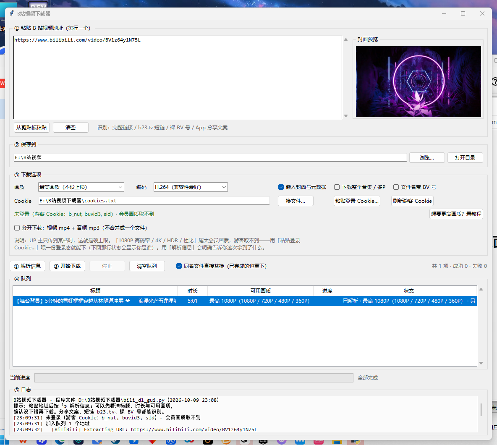
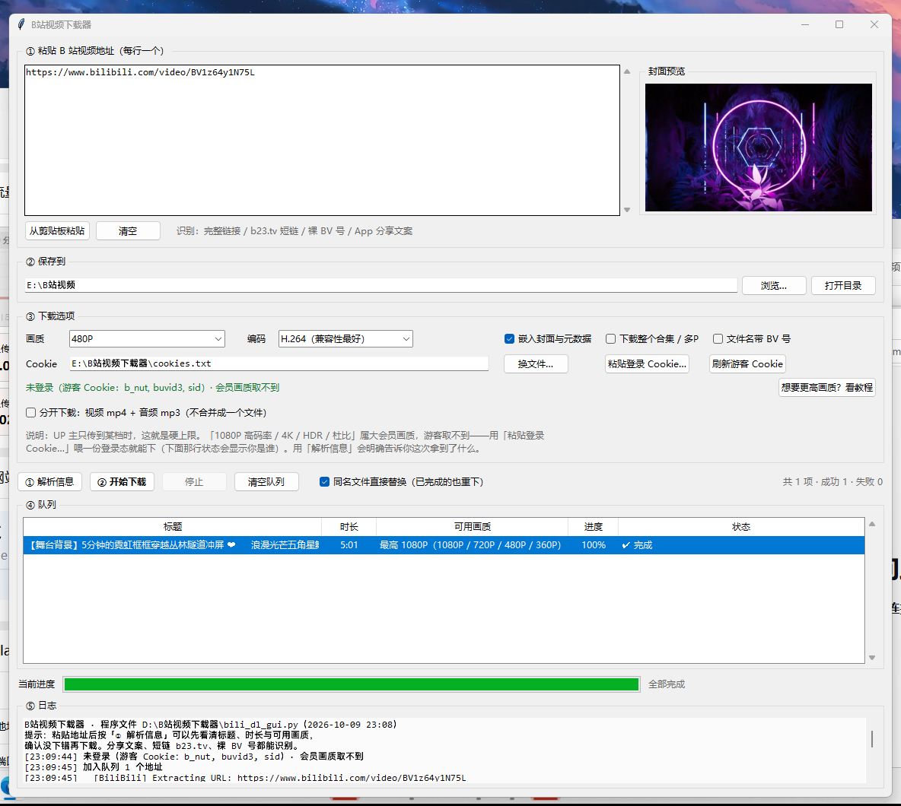
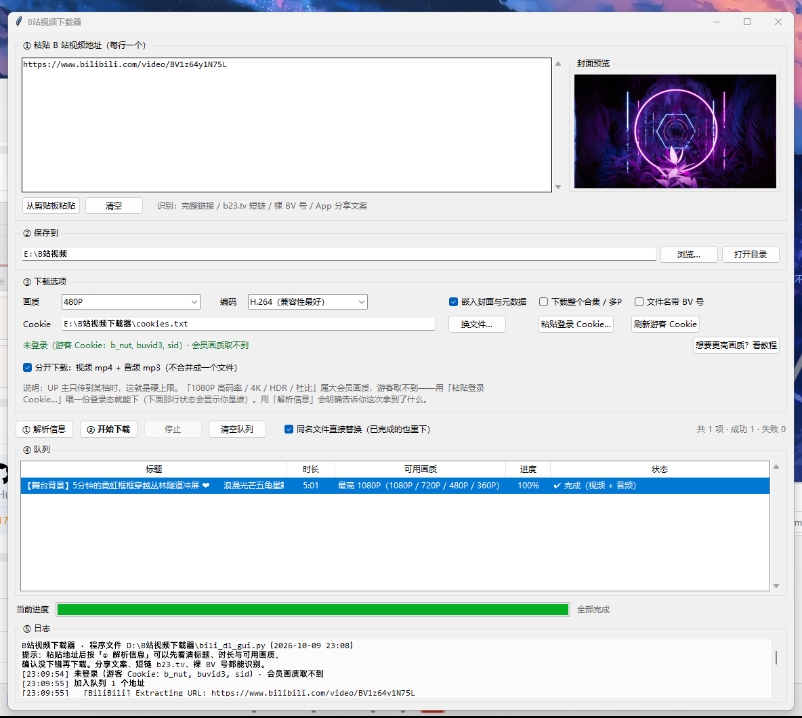
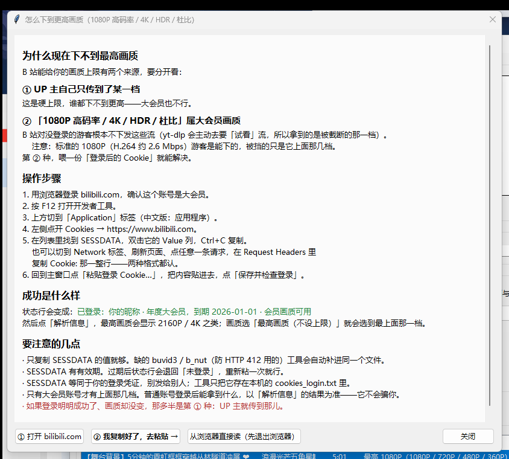

# B站视频下载器（图形界面）

粘贴 B 站视频地址就能下载的 Windows 桌面小工具。**界面只用 Python 自带的 tkinter**，
不需要 PyQt、Electron 那一套，主程序就是一个 `.py` 文件。

底层调用 [yt-dlp](https://github.com/yt-dlp/yt-dlp)，本仓库负责的是**好用**那部分：
游客 Cookie 自动处理、画质/编码选择、封面与元数据内嵌、队列、实时日志、失败定位。



---

## 功能

| 能力 | 说明 |
| --- | --- |
| **粘贴就下** | 完整链接、`b23.tv` 短链、裸 `BV` 号、App 分享文案都能识别 |
| **画质可选** | 最高画质（不设上限）/ 2160P / 1080P / 720P / 480P / 360P |
| **只要音频** | `原生 m4a（不转码）` 音轨原样取出，零代损失；或 `MP3 320k` |
| **分开下载** | 一个只有画面的 `.mp4` + 一个 320 kbps 的 `.mp3`（不合并） |
| **封面与元数据** | 内嵌封面 + 标题/UP主等标签，双击播放能看到图 |
| **队列** | 多个地址一起排队，逐条进度 + yt-dlp 实时日志，失败贴完整 traceback |
| **游客 Cookie 自动获取** | 不用手动折腾 cookie，首次启动自己去要一份 |
| **大会员画质** | 粘一份登录 Cookie，就能下 1080P 高码率 / 4K / HDR / 杜比 |
| **不瞎编信息** | 「解析信息」先把标题、时长、可用画质摆给你看，确认没下错再动手 |

---

## 环境要求

- **Windows**（界面是 tkinter，理论上 macOS / Linux 也能跑，但只在 Windows 上验证过）
- **Python 3.10+**（开发环境是 3.13；tkinter 是 Python 自带的，不用单独装）
- **[yt-dlp](https://github.com/yt-dlp/yt-dlp)**：真正干活的那个
- **[ffmpeg](https://ffmpeg.org/)**：合并音视频、转 mp3、内嵌封面都要它
- `mutagen` + `Pillow`：写元数据、显示封面预览

> **一个常见的坑**：`pip install -U yt-dlp` 之后，`yt-dlp.exe` 和 `ffmpeg.exe` 常常躺在
> Python 的 `Scripts` 目录里而**不在 PATH 上**。本工具会自己去那几个已知位置找，
> 找不到也不会崩 —— 只是视频和音频不会合并、封面不会内嵌，日志里会明确警告。

## 安装

```bash
git clone https://github.com/CHEN-qc256/bili-video-downloader.git
cd bili-video-downloader
python -m pip install -r requirements.txt
```

ffmpeg 单独装：`winget install Gyan.FFmpeg`，或者去官网下压缩包解压后把 `bin` 目录加进 PATH。

## 启动

双击 **`启动.bat`**（用 `pythonw` 起，不留黑框），或者：

```bash
python bili_dl_gui.py
```

日志**第一行**会打印「程序文件 `<路径>`（`修改时间`）」。当你改过代码却没看到变化时，
先看这一行 —— 多半是双击了另一个没同步的副本。

## 使用

1. 把地址粘进「① 粘贴 B 站视频地址」，**每行一个**。
2. 按 **「① 解析信息」** —— 先看清标题、时长、可用画质。
3. 按 **「② 开始下载」**。



能识别的输入：

| 形式 | 例子 |
| --- | --- |
| 完整链接 | `https://www.bilibili.com/video/BV1z64y1N75L?spm_id_from=...` |
| 短链 | `https://b23.tv/xxxxx` |
| 裸 BV 号 | `BV1z64y1N75L` |
| App 分享文案 | `【【4K修复】周杰伦 - 花海MV】 https://b23.tv/xxxxx` |

链接尾巴上的 `spm_id_from` / `vd_source` 会被自动处理，同一个 BV 号不会重复入队。

## 选项

- **画质**：最高画质 / 2160P / 1080P / 720P / 480P / 360P，或仅音频。
  - `仅音频 · 原生 m4a（不转码）`：音轨原样取出，零代损失，音质最好的选择。
  - `仅音频 · MP3 320k`：给老设备用；这是再压一代。
- **编码**：H.264 兼容性最好；AV1 同画质体积最小（实测同一个 1080P：AV1 62.7 MB
  vs H.264 94.4 MB）；HEVC 居中。
- **嵌入封面与元数据**：把封面写进文件，双击播放时能看到图。
- **下载整个合集 / 多P**：勾上后 yt-dlp 会遍历整个分P / 合集。
- **文件名带 BV 号**：方便回溯来源；默认不带，名字更干净。
- **同名文件直接替换（已完成的也重下）**：**默认勾选**。勾上时，同一个视频再点一次
  「② 开始下载」会真的重下一遍，磁盘上的同名文件被换掉；取消勾选则跳过已经下好的项，
  只补失败的和新加的。
- **分开下载：视频 mp4 + 音频 mp3（不合并）**：**默认不勾**。勾上后同一个视频会出**两个文件**
  —— 一个**只有画面**的 `.mp4`（没有音轨）和一个 **320 kbps 的 `.mp3`**（只有声音）。
  适合「视频拿去剪辑、音频拿去听」这类用法。

  

  - 代价：**会下两遍**（一遍画面、一遍声音），所以耗时和流量大约是原来的 1.5–2 倍。
    B 站本来就是音视频分离的 DASH 流，「合并」才是那个额外步骤。
  - 画质下拉选「仅音频」时这个勾选框会**变灰** —— 没有画面可拆，勾了也没意义。
- 双击队列里已完成的那一行，直接用默认播放器打开文件。

## 画质上限是怎么回事

界面上那句提示不是套话，B 站的画质上限有**两个独立来源**：

1. **UP 主自己只传到了某一档**。`yt-dlp -F` 里完全没有会员提示时，这就是硬上限，
   大会员也下不到更高 —— 不是工具的问题。
2. **「1080P 高码率 / 4K / HDR / 杜比」是大会员画质**。yt-dlp 会提示
   `Format(s) 1080P 高码率 are missing; you have to become a premium member...`。
   注意：**标准 1080p（H.264 约 2.6 Mbps）游客是可以下的**，被挡住的只是它上面那几档。

「解析信息」会把这两种情况区分开告诉你。发现是第 2 种时，队列状态里会多一句
「另有大会员画质」。

## 登录大会员账号，就能下大会员画质

**可以。** 前提只有一个：喂给 yt-dlp 一份带 **`SESSDATA`** 的 cookie。

> yt-dlp 判断「登录了没」就只看这一个字段：
> `is_logged_in = bool(cookies.get('SESSDATA'))`。登录后它才会去要完整播放信息，
> 否则会主动请求「试看」流，画质自然被截断。

界面上的 Cookie 那一行右边有个 **「想要更高画质？看教程」** 按钮，点开就是完整教程
（含「① 打开 bilibili.com」和「② 我复制好了，去粘贴 →」，照着一路点完即可）：



1. 浏览器里登录 bilibili.com → `F12` → **Application → Cookies → https://www.bilibili.com**
2. 找到 **`SESSDATA`**，复制它的**值**（也可以直接复制任意一条请求的「Cookie 头」整条，两种都认）
3. 粘进弹窗 → **「保存并检查登录」**

工具会把这份 cookie 存成**单独的** `cookies_login.txt`（**不会覆盖**游客的 `cookies.txt`），
然后立刻问一次 B 站的 `x/web-interface/nav`，把结果写在下拉框下面那行状态里：

- 成功：`已登录：你的昵称 · 年度大会员，到期 2026-01-01 · 会员画质可用`
- 没成功：`未登录（游客 Cookie：...）· 会员画质取不到`

之后「解析信息」里最高画质就会变成 `2160P` / `4K` 之类，选「最高画质（不设上限）」即可。

几点说明：

- 粘贴时**只有 SESSDATA 也够**，缺的 `buvid3` / `b_nut`（清 412 用的）工具会自动补进同一个文件。
- `SESSDATA` 有有效期，过期后会退回「未登录」，重新粘一次即可。
- `SESSDATA` 等同于你的登录凭证，**别发给别人**；它只存在本机的 `cookies_login.txt` 里。
- 弹窗里还有个 **「从浏览器直接读」** 兜底按钮，但**必须先把浏览器完全退出** —— 浏览器在跑的时候
  会独占锁住自己的 cookie 数据库（实测 Edge 会报 `Could not copy Chrome cookie database`）。
- 如果登录明明成功了画质却没变，那多半是上面第 1 种情况：UP 主就传到那儿。

## Cookie

B 站不带 cookie 请求会直接回 **HTTP 412**，所以工具需要 `cookies.txt`。它会：

- 首次启动**自动**去 B 站要一份**游客 cookie**（拿到 `buvid3` / `b_nut`），存到程序目录；
- 游客 cookie 足够清掉 412，也够下所有**非会员**流；
- 想要会员画质，再用上面那份登录 Cookie。

**为什么不默认「从浏览器读取 cookie」**：浏览器常驻时会独占锁住 cookie 数据库，
读取必然失败（`Could not copy Chrome cookie database` → `[WinError 5] 拒绝访问`），
所以那条路只当最后手段保留。

## 常见问题

**Q：点了「② 开始下载」，按钮那一行不见了？**
历史上真出现过，原因是 Tk 的 grid 在窗口比内容矮时按各行权重扣空间，按钮行有权重就被扣光
（封面一显示，上方区域会长高 90px，正好把它压垮）。现在按钮行权重是 0，并且窗口会跟着内容
自动长高，自检里也有专门的回归断言盯着这件事。如果你还遇到，把 `_probe_after.py` 的输出发出来。

**Q：改了代码却没生效？**
看日志第一行打印的程序路径，确认你双击的和改的是**同一份**。

**Q：下下来的视频没有声音？**
只有两种可能：勾了「分开下载」，或者 yt-dlp 找不到 ffmpeg 所以没能合并。日志里会写明。

**Q：下载很慢 / 卡住？**
B 站对大文件会限速，属于正常现象；进度条卡住时看日志有没有在走。

## 自带回归自检

这个项目写了一套会**真下载**的自检脚本，改完代码跑一遍再提交：

```bash
python _selftest.py          # 97 项检查：纯函数 + 建界面 + 用界面自己的路径真下一次
python _selftest.py --keep   # 保留测试产物，方便对着一堆临时文件排查
python _screenshot.py            # 拍主界面
python _screenshot.py --download # 拍「下载完成」
python _screenshot.py --split    # 拍「分开下载」
python _screenshot.py --guide    # 拍「画质教程」弹窗
python _probe_after.py           # 下载前后各 dump 一次所有控件几何，专治「控件不见了」
```

自检覆盖的东西包括：链接解析、格式挑选、错误的输入、Cookie 写入/读回（含编码）、
窗口尺寸与按钮可见性、封面内嵌、同名替换、分开下载的产物到底有没有音轨 ——
**都是拿真实下载的文件去验的**，不是只在内存里算。

## 文件说明

| 文件 | 说明 |
| --- | --- |
| `bili_dl_gui.py` | 主程序（单文件，全部逻辑都在里面） |
| `启动.bat` | 双击启动 |
| `requirements.txt` | Python 依赖 |
| `settings.json` | 上次用的选项，自动生成，可删 |
| `cookies.txt` | 游客 cookie，自动生成，可删（会重新获取） |
| `cookies_login.txt` | 你粘贴的登录 cookie（大会员画质用），只有粘过才会有，可删 |
| `_selftest.py` | 回归自检（会真下载） |
| `_screenshot.py` | 给界面拍图，存到 `screenshots/` |
| `_probe_after.py` | 诊断「控件不见了」的几何 dump 工具 |
| `screenshots/` | README 里用的图 |

## 已知限制

- 只在 Windows 上验证过；路径、DPI、`pythonw`、`启动.bat` 都是按 Windows 写的。
- 需要 **Python + yt-dlp + ffmpeg**，不是开箱即用的单文件 exe。
  （打包成 exe 需要在别的机器上做，且未签名的 exe 会让下载者撞 SmartScreen，所以没做。）
- B 站的接口随时可能变；出问题先 `python -m pip install -U yt-dlp`，八成能好。
- 播放列表 / 合集是一口气遍历的，中途失败的那几条会在队列里标出来，不会静默跳过。

## 免责声明

本项目**仅供个人学习与技术交流**，请仅用于下载你有权获取的内容（例如自己的投稿、
已获授权的素材、B 站允许离线观看的内容）。

- 请遵守 [B 站用户协议](https://www.bilibili.com/protocol/) 与相关法律法规；
- **不要**用它批量抓取、二次分发或商业利用他人作品；
- 下载内容的版权归原作者/权利人所有；
- 使用本工具产生的一切后果由使用者自负。

## License

[MIT](LICENSE)
